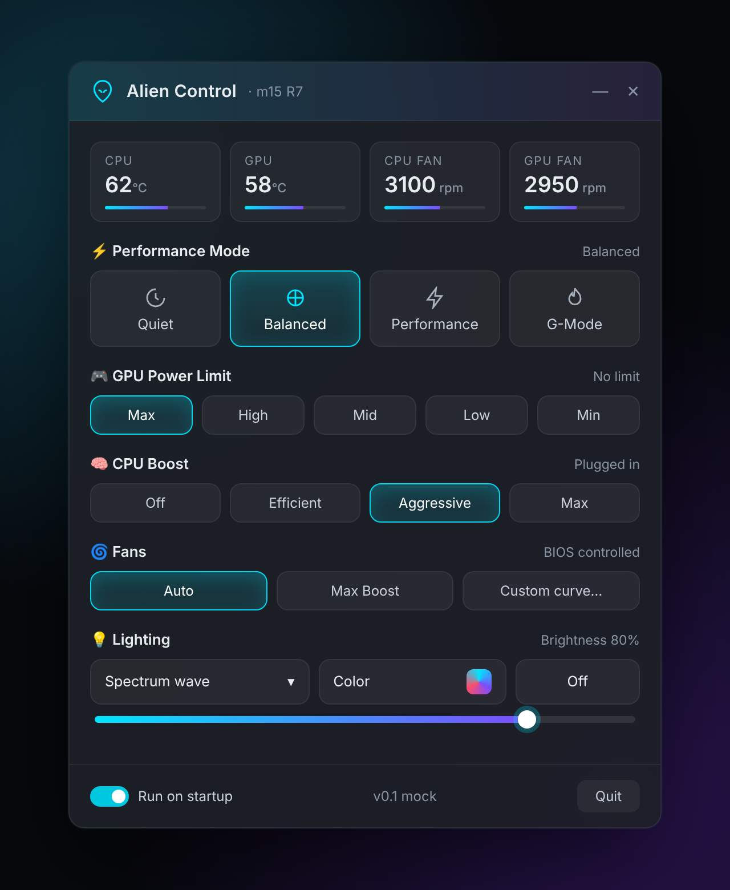

# Alien Control

A lightweight, G-Helper-style control panel for the **Alienware m15 R7**, built on top of
[T-Troll's AlienFX Tools](https://github.com/T-Troll/alienfx-tools). It replaces Alienware
Command Center, whose background services keep *WMI Provider Host* busy.



## How it works

Alien Control is GUI only. Every button runs one of T-Troll's command-line tools:

| Feature | Tool | Command |
|---|---|---|
| Performance mode | alienfan-cli | `setpower=<n>`, `getpower` |
| G-Mode | alienfan-cli | `setgmode=1/0`, `gmode` |
| CPU boost | alienfan-cli | `setperf=<ac>,<dc>` |
| Fans | alienfan-cli | `setfans=<boost>,<boost>` |
| Temps / RPM | alienfan-cli | `temp rpm` |
| Lighting (per-key keyboard + chassis) | alienfx-cli | `setone` on every light ID, `setdim`, `setglobal` |
| G-key (F1) | app | global keyboard hook, toggles `setgmode` |

Sensors are polled only while the window is open; closed, it idles in the tray.

## Setup

1. Stop and disable the AWCC services (`services.msc`).
2. Download the latest [alienfx-tools release](https://github.com/T-Troll/alienfx-tools/releases),
   copy `alienfan-cli.exe`, `alienfx-cli.exe` (plus their DLLs) into `tools/` next to `AlienControl.exe`.
   On Intel systems also copy the `DPTF` files as described in T-Troll's README.
3. Run Alien Control as administrator. Defaults are set for the m15 R7; other models can edit
   `%AppData%\AlienControl\settings.json`.
4. Click **Detect key** and press the G-key (F1) once so the app learns its key code.

### m15 R7 power modes (verified)

| `setpower=` | `getpower` raw | Mode |
|---|---|---|
| 1 | a0 | Balanced |
| 2 | a1 | Balanced-Performance |
| 3 | a5 | Battery Saver |
| 4 | a3 | Quiet |
| 5 | a4 | Performance |

`setgpu` is not in alienfan-cli v9.6, so there is no GPU power limit control.
The keyboard is per-key RGB (APIv5) and its light IDs don't follow key order, so colors are
sent to IDs 0 to 135. Any software color takes the keyboard out of firmware mode, which stops it
lighting the status keys, so the app drives them itself: F1 (G-Mode) = 1, F12 (touchpad lock) = 12,
speaker mute = 16, mic mute = 19, right Windows lock = 109. They turn white when on.
The power-button Alienhead is never touched. Avoid `alienfx-cli probe` on the keyboard: interrupting it
leaves keys dark until a reboot.

## Build

```
dotnet publish src/AlienControl/AlienControl.csproj -c Release -r win-x64 --self-contained false -o publish
```

Every push to `main` also builds on GitHub Actions and uploads the app as an artifact.

Stack: C# · .NET 8 · WPF · [WPF-UI](https://github.com/lepoco/wpfui) (Fluent look).

## Credits

All hardware control is done by [alienfx-tools](https://github.com/T-Troll/alienfx-tools)
by T-Troll and contributors (MIT license).
RAM clean idea from [WinMemoryCleaner](https://github.com/IgorMundstein/WinMemoryCleaner) and GPU modes from [G-Helper](https://github.com/seerge/g-helper). Both ideas are reimplemented here, and no code was copied.

## Status

v0.7: click the RAM card for a quick clean, right-click for a deep clean. GPU modes Eco / Standard / Ultimate (MUX via Dell BIOS WMI when exposed) / Optimized.
v0.6: effect dropdown, Spectrum and Rainbow wave, custom RGB picker.
v0.3: status keys (G-Mode, mutes, touchpad lock) lit by the app, last color reapplied at start.
v0.2: verified power mode map, G-key support, per-key lighting fix, Breathe/Wave effects, GPU limit removed.
