# Alien Controls

> [!CAUTION]
> ## 🚨 Read this first
> **This is a personal project, purpose-built for my own Alienware m15 R7.** There are no plans to support other laptops
> for now. It drives fans, power modes, the BIOS GPU switch and GPU clocks directly, so on any other model it may do the
> wrong thing.
>
> **I am not responsible for any damage to your laptop, your data or anything else. You use it entirely at your own risk.**
> **Read the code and understand what it does before you run it.**
>
> Better yet, treat it as a **proof of concept**: a starting point for more capable developers to build a proper
> G-Helper-style tool for Alienware / Dell laptops. Unofficial, not affiliated with Dell or Alienware, and built with the
> help of AI. See [Disclaimer](#disclaimer) and [AI disclosure](#ai-disclosure).

A lightweight, G-Helper-style control panel for the **Alienware m15 R7**, built on top of
[T-Troll's AlienFX Tools](https://github.com/T-Troll/alienfx-tools). It replaces Alienware
Command Center, whose background services keep *WMI Provider Host* busy.

**[⬇️ Download the latest release](https://github.com/aminenrr/alien-control/releases/latest)** · [Installation guide](#installation)

## Contents

- [Screenshots](#screenshots)
  - [Notifications (F1, F2, plug / unplug)](#notifications-f1-f2-plug--unplug)
- [Features](#features)
- [Idle cost](#idle-cost)
- [Documentation](#documentation)
- [How it works](#how-it-works)
- [Installation](#installation)
  - [1. Install the .NET 8 Desktop Runtime](#1-install-the-net-8-desktop-runtime)
  - [2. Download Alien Controls](#2-download-alien-controls)
  - [3. Add the two alienfx-tools CLIs](#3-add-the-two-alienfx-tools-clis)
  - [4. Turn off AWCC](#4-turn-off-awcc)
  - [5. Run it](#5-run-it)
  - [6. Check the hotkeys](#6-check-the-hotkeys)
  - [Updating](#updating)
  - [Uninstalling](#uninstalling)
  - [m15 R7 power modes (verified)](#m15-r7-power-modes-verified)
- [Themes and settings](#themes-and-settings)
  - [Tray profiles](#tray-profiles)
  - [GPU mode](#gpu-mode)
- [Build](#build)
- [Security & Privacy](#security--privacy)
- [Credits](#credits)
- [Disclaimer](#disclaimer)
- [AI disclosure](#ai-disclosure)
- [License](#license)
- [Status](#status)
- [Issues and support](#issues-and-support)

## Screenshots

### Compact view (tray, F3)

| Legend | Fluent |
|---|---|
| 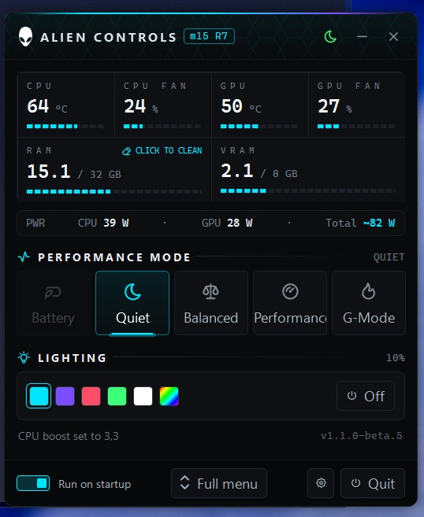 | 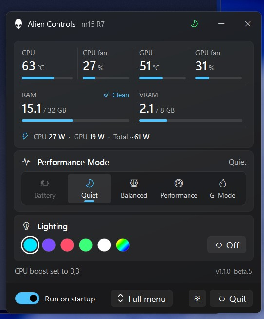 |

### Full menu (F4 or the Full menu button)

| Legend | Fluent |
|---|---|
| 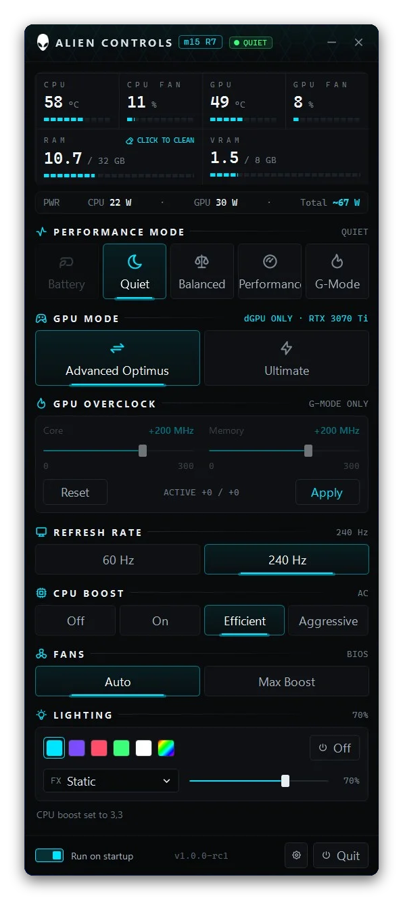 | 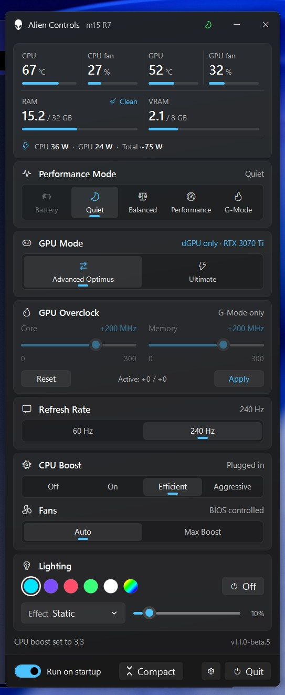 |

### Preset button and settings

| Preset list (header button) | Gear menu |
|---|---|
| 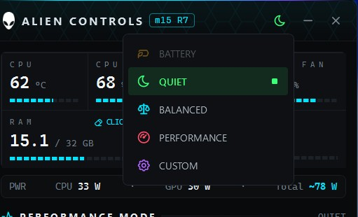 | 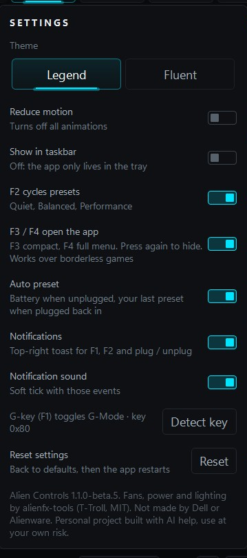 |

### Notifications (F1, F2, plug / unplug)

| F2 cycle | F1 G-Mode | Auto preset |
|---|---|---|
| 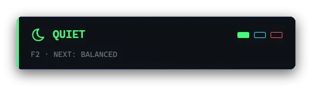 |  |  |
|  | 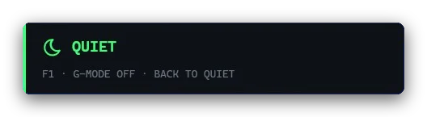 |  |
| 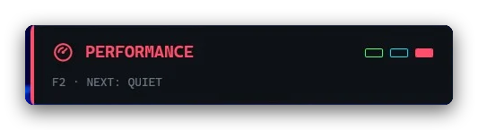 | | |

*Real screenshots from the m15 R7 (Legend theme). The plug / unplug toasts are recreated from a real toast with the same layout.*

## Features

- **Compact view** (v1.1): the tray and **F3** open a short window (sensors, power, modes, light colors); **F4** or the footer button opens the full menu. F3 / F4 hide it again, games included (borderless).
- Presets from the tray, the header preset button, the window or **F2**: Battery, Quiet, Balanced, Performance (power mode, CPU boost, refresh rate), plus Custom.
- **F1 G-Mode**: fans max, Aggressive CPU boost, optional GPU overclock (core / memory offsets, AC only, keep-or-revert test).
- **GPU OC in Performance** (v1.3.4): a toggle with the Performance icon in the GPU Overclock header. Lit (Performance
  red) = your kept offsets also run in the Performance preset on AC, and the header reads **G-MODE + PERF** in your
  lighting colour. Dark (default) = G-Mode only. The Performance and G-Mode on toasts show **OC +core / +mem** in red when
  it runs, or a grey **OC off**.
- **Auto preset**: Battery when unplugged, your last preset when plugged back in.
- Fans, temps, **CPU % / GPU %** (v1.3) and CPU / GPU / total power readout while the window is open. Temps and fans come straight from the AWCC WMI interface (v1.1, ~2.5x faster than the CLI, CLI fallback).
- Per-key keyboard color and effects, chassis lights, status keys (G-Mode, mutes, touchpad) lit by the app.
- **Lights menu** (v1.3.1): a laptop button opens tiles for the keyboard, the rear ring and the Alienhead (lit = on,
  tap to switch) plus Turn off / Turn on. F7 still sets the keyboard level after it's off. The power button light is never touched.
- **Keyboard light timeout** (v1.3): fades the keys out after 1 / 2 / 5 / 10 min without input (optionally on battery
  only, paused in fullscreen games); any key, mouse or touchpad input brings them straight back.
- GPU mode: Advanced Optimus / Ultimate through the Dell BIOS switch (restart prompt), plus **iGPU only** (v1.2): turns the RTX off for battery life when NVIDIA is set to Optimus. It lists the apps using the RTX first, and HDMI / Mini DP stay dark until you switch back.
- Toasts for F1, F2 and plug / unplug (v1.3): a **Pill** at the top center (default) or the 1.2 **Classic** card in the
  top right, with a chime per preset from the **Soft** (default) or **Classic** pack. Since v1.3.4 they also show the GPU OC state.
- Locked buttons (Battery under Auto preset, iGPU only outside Optimus) show a small lock; click a locked iGPU only to see why.
- Two themes (Legend, Fluent), Reduce motion, Show in taskbar (off = tray only), Reset settings. One exe, ~0% CPU and a few MB of RAM in the tray.

## Idle cost

Measured on my m15 R7 (v1.0.0, Task Manager):

| State | CPU | RAM |
|---|---|---|
| Window open, idle | 0% | ~20 MB |
| Window open, busy (switching, sensors) | brief spikes | ~40 MB |
| In the tray | 0% | a few MB |

How it stays that small:
- Sensors (temps, fans, watts) are polled only while the window is open; closed, nothing polls.
- Status keys (mute, mic, touchpad) update from Windows events (audio endpoint and registry callbacks), with a 30 s safety check.
- Memory is trimmed a minute after the window hides or a toast closes (a quick reopen stays snappy), and 10 s after starting to the tray.
- One framework-dependent ReadyToRun exe (faster start, no self-contained runtime). The release zip is ~3.3 MB.
- No blur or Mica, and only the active theme is loaded.

## Documentation

- [Hardware findings](docs/HARDWARE.md): everything measured on the m15 R7 (power map, light IDs, the status-key root cause)
- [Decisions log](docs/DECISIONS.md): why the app works the way it does
- [Development guide](docs/DEVELOPMENT.md): code layout, build, theme generator, mockups, workflow
- [Changelog](docs/CHANGELOG.md) and [Roadmap](docs/ROADMAP.md)

## How it works

Alien Control is GUI only. Every button runs one of T-Troll's command-line tools:

| Feature | Tool | Command |
|---|---|---|
| Performance mode | alienfan-cli | `setpower=<n>`, `getpower` |
| G-Mode | alienfan-cli | `setgmode=1/0`, `gmode` |
| CPU boost | alienfan-cli | `setperf=<ac>,<dc>` |
| Fans | alienfan-cli | `setfans=<boost>,<boost>` |
| Temps / RPM | alienfan-cli | `temp rpm` |
| Lighting (per-key keyboard + chassis) | alienfx-cli | `setone` on every light ID, `setdim`, `setglobal` |
| G-key (F1) | app | global keyboard hook (always on), toggles `setgmode` |
| Refresh rate 60 / 240 Hz | app | `EnumDisplaySettings` / `ChangeDisplaySettingsEx` on the primary display (resolution kept) |
| Power readout (every 1 s) | app | CPU: `\EsifDeviceInformation(*)\RAPL Power` (Intel DTT) · GPU: NVIDIA NVML (`nvml.dll`, plugged in only) · Total: battery discharge rate on battery; on AC an estimate `~N W` = CPU + GPU + rest of the laptop (learned on battery) |
| GPU mode | app | Dell BIOS graphics switch (Advanced Optimus / Ultimate) and NVIDIA's display mode for the hint |

Sensors are polled only while the window is open; closed, it idles in the tray.

## Installation

> [!WARNING]
> Made and tested only on the **Alienware m15 R7**. Read the caution box at the top first.

**You need:** Windows 10 / 11 (64-bit), admin rights, and about 5 minutes.
You do **not** need to install AWCC, the AlienFX app (`alienfx-gui`) or any driver. Alien Controls only uses two
small command-line tools from the alienfx-tools zip.

### 1. Install the .NET 8 Desktop Runtime

Download **.NET Desktop Runtime 8 (x64)** from [Microsoft](https://dotnet.microsoft.com/download/dotnet/8.0) and
install it. Skip this if you already have it.

### 2. Download Alien Controls

Get `AlienControl-<version>-win-x64.zip` from the
[Releases page](https://github.com/aminenrr/alien-control/releases/latest) and unzip it into **`C:\Program Files\Alien Controls`** (create the folder; Windows asks for admin).
The app runs as administrator, so its folder should only be changeable by admins: a folder like `C:\Tools` can be
written by any program, which could swap a file there and get admin rights. The app warns you if its folder is
writable without admin rights.

### 3. Add the two alienfx-tools CLIs

1. Open the [alienfx-tools releases](https://github.com/T-Troll/alienfx-tools/releases/latest) and download
   **`alienfx-tools.zip`** (not the `.msi` installer and not `fan-SDK_V1.zip`).
2. From that zip, copy only these two files into the same folder as `AlienControl.exe`:
   - `alienfan-cli.exe` (fans, power modes, G-Mode, CPU boost, temps)
   - `alienfx-cli.exe` (keyboard and chassis lighting)

   A `tools\` subfolder next to the exe works too. You don't need anything else from the zip.
3. Use alienfx-tools **9.6.x** (9.6.1 to 9.6.2.1). Since 1.3 the app checks the SHA-256 of both CLIs against T-Troll's
   published 9.6.x builds and refuses to run anything else (the hash goes to `crash.log` if it refuses).

Your folder should look like this:

```
C:\Program Files\Alien Controls\
  AlienControl.exe
  alienfan-cli.exe
  alienfx-cli.exe
```

### 4. Turn off AWCC

AWCC and Alien Controls fight over the same hardware, so turn AWCC off:

1. Press `Win + R`, type `services.msc`, press Enter.
2. For each **Alienware / AWCC** service: right-click, then **Properties**. Set **Startup type** to **Disabled**,
   click **Stop**, then **OK**.
3. Also close or disable AWCC in **Task Manager → Startup apps** if it's there.

You can undo this anytime by setting the services back to Automatic.

### 5. Run it

1. Double-click `AlienControl.exe` and accept the admin prompt (fan and power control need admin).
   Windows SmartScreen may warn because the exe isn't signed: click **More info → Run anyway**.
2. The compact window opens and the app lives in the tray (the Alienhead icon). Click **Full menu** for every setting.
3. Turn on **Run on startup** at the bottom of the window. It starts with Windows, in the tray, without an admin prompt.

### 6. Check the hotkeys

- **F1** toggles G-Mode, **F2** cycles the presets, **F3** opens / hides the compact view, **F4** the full menu.
- If F1 does nothing, open the gear (next to Quit) > **Keys**, click **Detect key**, and press F1 once.

### Updating

Close the app from the tray (**Quit**), replace `AlienControl.exe` with the new one, and start it again.
Keep the two CLIs. Settings stay in `%AppData%\AlienControl`.

### Uninstalling

If **iGPU only** is on, switch back to Advanced Optimus first (or say *Turn it on* when Quit asks): the RTX stays
disabled after uninstalling otherwise, and `pnputil /enable-device` or Device Manager is the only way back. Quit also
removes the Quiet preset's 3.0 GHz CPU cap from your power plan (if you uninstall without quitting, run
`powercfg /setacvalueindex scheme_current sub_processor PROCFREQMAX 0` and the same with `setdcvalueindex`).

Turn off **Run on startup**, quit the app, and delete the folder (and `%AppData%\AlienControl` if you want the settings
gone). Set the AWCC services back to Automatic if you want AWCC again.

### m15 R7 power modes (verified)

| `setpower=` | `getpower` raw | Mode |
|---|---|---|
| 1 | a0 | Balanced |
| 2 | a1 | Balanced-Performance |
| 3 | a5 | Battery Saver |
| 4 | a3 | Quiet |
| 5 | a4 | Performance |

`setgpu` is not in alienfan-cli v9.6, so there is no GPU power limit control.
The keyboard is per-key RGB (APIv5) and its light IDs don't follow key order, so colors are
sent to IDs 0 to 135. Any software color takes the keyboard out of firmware mode, which stops it
lighting the status keys, so the app drives them itself: F1 (G-Mode) = 1, F12 (touchpad lock) = 12,
speaker mute = 16, mic mute = 19, right Windows lock = 109. They turn white when on.
The power-button Alienhead is never touched. Avoid `alienfx-cli probe` on the keyboard: interrupting it
leaves keys dark until a reboot.

## Themes and settings

Two themes, switched on the settings page (gear > General) (saved in settings, default **Legend**):

- **Legend**: Alienware-style terminal look, mono numbers and icon section headers, tick bars, cyan accent.
- **Fluent**: Windows 11 cards, segmented controls and rounded bars.

Each theme is its own ResourceDictionary (`Themes/Legend.xaml`, `Themes/Fluent.xaml`); only the active one is loaded. No blur or Mica (a native Acrylic backdrop was tried in 1.1.0-beta.2 and dropped: it cost CPU and RAM for little gain), and the app idles at ~0% CPU.
The accent follows the lighting color.

Since v0.8.2 there are a few subtle, one-shot animations: since v0.8.6 the window slides up out of the bottom edge when shown
and back down before hiding to the tray, like the Windows 11 Quick Settings flyout; buttons fade their hover and shrink slightly when pressed, a newly selected mode grows its
underline and pulses once, the preset button fades to its new color, and the settings page swaps in like the compact / full switch. They animate
only opacity and scale/position, are capped at 60 fps, never loop and never run while the window is hidden.
**Reduce motion** (gear > General) turns all of them off (saved in settings, off by default).

Since v1.3 the gear opens a **settings page** inside the window (back arrow or Esc), with five tabs:
**General** (theme, run on startup, show in taskbar, reduce motion, auto preset), **Keys** (Detect key for the G-key,
F2 presets, F3 / F4), **Alerts** (notifications, toast style + Test, sound, chime pack + preview), **Backlight**
(keyboard light timeout) and **Advanced** (frame-gap log, **Reset settings**: back to defaults and restart; startup,
BIOS and GPU mode untouched, and the version / credits line).

### Tray profiles

Left-click the tray icon to open the window, or to slide it back to the tray when it is open (v0.8.7).
Right-click it for the menu, drawn in the active theme with accent-colored text (v0.8.7): Battery (amber), Quiet (green), Balanced (cyan), Performance (red), Custom (violet); G-Mode shows white.
A profile sets the power mode, CPU boost and refresh rate: Battery (boost Off, 60 Hz), Quiet (Efficient, 240 Hz),
Balanced (On, 240 Hz), Performance (Aggressive, 240 Hz). Custom changes nothing. Profiles never touch the GPU mode and never use Ultimate.
The header has a preset button next to minimize (v1.1): the active preset's icon in its color. Click it for the list of
presets, each with its icon and color. It follows tray picks, mode buttons, F2 and refresh rate changes.

### GPU mode

Three buttons: **iGPU only**, **Advanced Optimus** and **Ultimate**. The hint on the right shows what drives the screen
(Optimus · Iris Xe, Auto · RTX 3070 Ti, dGPU only · RTX 3070 Ti); change that from NVIDIA's own app.
Switching between Advanced Optimus and Ultimate sets the Dell BIOS graphics switch and asks to restart.
**iGPU only** (v1.2) turns the RTX off with `pnputil` for battery life. It only works in Advanced Optimus with NVIDIA set to
Optimus, lists the apps using the RTX first, and locks Ultimate while it's off. HDMI / Mini DP stay dark, and it
**survives restarts and uninstalling** until you click Advanced Optimus again (Quit offers to turn it back on).
Locked buttons show a small lock. Presets never change the GPU mode.

| Legend | Fluent |
|---|---|
| 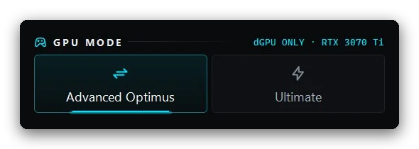 | 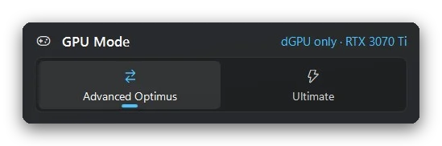 |

## Build

```
dotnet publish src/AlienControl/AlienControl.csproj -c Release -r win-x64 -o publish
```

Publishing gives one ReadyToRun `AlienControl.exe` (needs the .NET 8 Desktop Runtime) plus `tools/`.

Every push to `main` also builds on GitHub Actions, runs the unit tests (`tests/AlienControl.Tests`) and uploads the
app as an artifact. Actions are pinned to commit SHAs, and each release has a `SHA256SUMS` file next to the zip.

Stack: C# · .NET 8 · WPF · [WPF-UI](https://github.com/lepoco/wpfui) (Fluent look).

## Security & Privacy

**Alien Controls does nothing on the network.** It has no HTTP client, no sockets, no update check, no telemetry,
analytics or crash reporting, no accounts and no listening ports. Nothing leaves your PC.

What it does locally, and why:
- **Runs as administrator.** It needs admin for the AWCC / Dell BIOS WMI calls, the keyboard HID, `pnputil` (iGPU only)
  and the startup task. Nothing else asks for more rights than that.
- **Runs only fixed programs**: the two alienfx-tools CLIs next to the exe, plus Windows' own `pnputil`, `powercfg`,
  `schtasks`, `shutdown` and `net` (only to restart NVIDIA's Display Container after iGPU only), always called by their
  full System32 path, never looked up through PATH. Arguments are built by the app, never taken from outside input.
- **Checks what it runs** (v1.3): the two CLIs must match T-Troll's published 9.6.x SHA-256 hashes, and are held
  open (no writes) while they run; `nvml.dll` is loaded only from System32. Settings are clamped to safe values on load.
- **Stores** only its settings (written atomically, with a `.bak`) and a local log in `%AppData%\AlienControl` (no secrets, no personal data). There are no keys, tokens
  or passwords in the code.
- **Reads** sensors, BIOS attributes, adapter state and the GPU memory of running apps (for the "RTX in use" list)
  locally; none of it is saved or sent anywhere.

If a network feature is ever added (for example an opt-in update check), it will be off by default, HTTPS only
(TLS 1.2+, certificate validation on), use one fixed GitHub endpoint, parse the reply defensively, send nothing about
you, and be listed here.

The only network traffic is yours: downloading the release from GitHub and the alienfx-tools CLIs from T-Troll's repo.

## Credits

All hardware control is done by [alienfx-tools](https://github.com/T-Troll/alienfx-tools)
by T-Troll and contributors (MIT license).
Legend theme icons: [Tabler Icons](https://tabler.io/icons) (MIT license). Fluent theme icons: Fluent System Icons via
[WPF-UI](https://github.com/lepoco/wpfui) (MIT), fan icon from [Phosphor](https://phosphoricons.com) (MIT).
RAM clean idea from [WinMemoryCleaner](https://github.com/IgorMundstein/WinMemoryCleaner) and GPU modes from [G-Helper](https://github.com/seerge/g-helper). Both ideas are reimplemented here, and no code was copied.

## Disclaimer

This project is not affiliated with or endorsed by Dell, Alienware, NVIDIA, Intel or Microsoft, or by the alienfx-tools
developers. It contains no Dell or Alienware software: the hardware is driven by T-Troll's alienfx-tools, which you
download yourself from their release page.

The app changes low-level settings: power modes and fans through the embedded controller, CPU boost, the Dell BIOS
graphics switch and NVIDIA GPU clock offsets. It was tested only on one Alienware m15 R7 (i7-12700H, RTX 3070 Ti
Laptop); other models or BIOS versions may behave differently or not work. GPU overclocking can make games or the
system unstable. Use it at your own risk.

Alienware is a trademark of Dell Inc. NVIDIA, GeForce and RTX are trademarks of NVIDIA Corporation. Intel is a
trademark of Intel Corporation. Windows is a trademark of Microsoft. They are named here only to describe what the
app works with.

## AI disclosure

This project was built with the help of AI (Hark). AI was used to read alienfx-tools and Dell's interfaces to find how
to control the laptop, to work out the hardware details in [docs/HARDWARE.md](docs/HARDWARE.md) together with probe
scripts I ran on the laptop (power mode map, light IDs, the macro keys, the GPU overclock limits), and to help write and
debug the code, the theme generator, the docs and the design mockups. The README screenshots are real, except the
plug / unplug toasts, which were recreated from a real toast. I tested every feature myself on my own laptop
(see [docs/RC-CHECKLIST.md](docs/RC-CHECKLIST.md)).

The AI (LLM) tools were used responsibly:

- **Verified on real hardware.** No hardware value was guessed: power modes, light IDs, key codes and OC limits were
  measured with probe scripts on the laptop before any code used them.
- **Reviewed, not blindly pasted.** Every change was read, built and tested by me before it was committed.
- **Small, safe steps.** Each feature shipped as its own small version and was tested before moving on, with risky
  parts (GPU mode, overclocking) behind confirmations and safe limits.
- **No reverse engineering of private code.** Only public interfaces and the open-source alienfx-tools were used.
- **Credited and open.** All code is public under MIT so anyone can check it, and third-party work is credited.

AI written code can contain mistakes, so please read the code before running it, especially because the app runs as
administrator and talks to the BIOS, the fans and the GPU.

## License

[MIT](LICENSE). Bundled alienfx-tools binaries and icon sets keep their own MIT licenses (see Credits).

## Status

**v1.3.5** (Lights menu and Ctrl + Alt + F from 1.3.1 to 1.3.3, plus GPU OC in the Performance preset and OC state on
toasts from 1.3.4), on top of **v1.3.0** (settings page with tabs, pill toasts, soft chimes, keyboard light timeout,
CPU / GPU %, smoother slides, security hardening). Known: the chime crackle is fixed as far as possible for now (much less noticeable); a faint one can remain during hardware switches. Download it from the
[Releases page](https://github.com/aminenrr/alien-control/releases/latest). Full history in the
[CHANGELOG](docs/CHANGELOG.md), next ideas in the [Roadmap](docs/ROADMAP.md).

## Issues and support

There is no support for other models, and issues or requests may go unanswered: this is a personal project.
Bug reports for the m15 R7 are welcome. Forks and pull requests that take the idea further are even more welcome.
