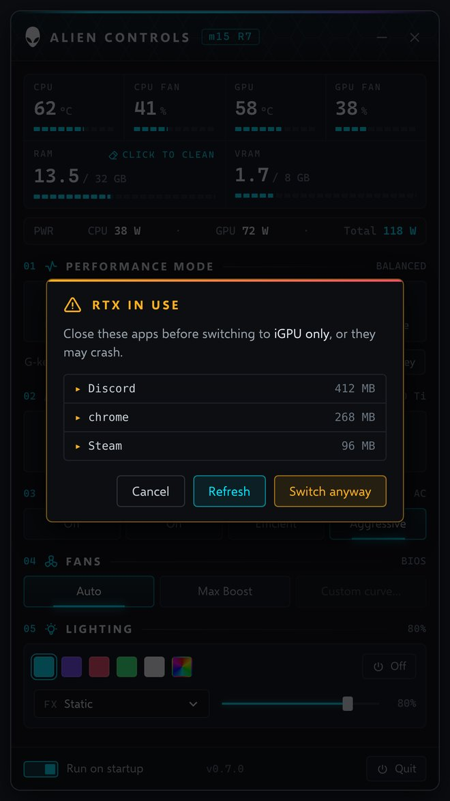
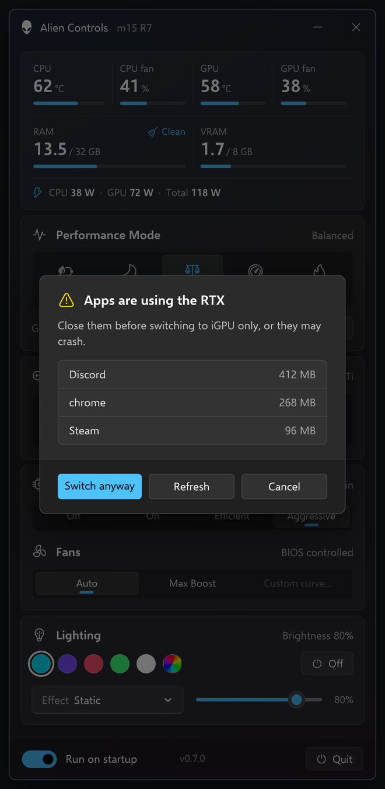

# Alien Controls

A lightweight, G-Helper-style control panel for the **Alienware m15 R7**, built on top of
[T-Troll's AlienFX Tools](https://github.com/T-Troll/alienfx-tools). It replaces Alienware
Command Center, whose background services keep *WMI Provider Host* busy.

| Legend theme | Fluent theme |
|---|---|
|  |  |

### Notifications (F1, F2, plug / unplug)

| F2 cycle | F1 G-Mode | Auto preset |
|---|---|---|
|  |  |  |
|  |  |  |

*Real screenshots from the m15 R7 (Legend theme). The plug / unplug toasts are recreated from a real toast with the same layout.*

## Features

- **F3** opens / hides the app from anywhere, games included (borderless).
- Presets from the tray, the window or **F2**: Battery, Quiet, Balanced, Performance (power mode, CPU boost, refresh rate), plus Custom.
- **F1 G-Mode**: fans max, Aggressive CPU boost, optional GPU overclock (core / memory offsets, AC only, keep-or-revert test).
- **Auto preset**: Battery when unplugged, your last preset when plugged back in.
- Fans, temps and CPU / GPU / total power readout while the window is open.
- Per-key keyboard color and effects, chassis lights, status keys (G-Mode, mutes, touchpad) lit by the app.
- GPU mode: Advanced Optimus / Ultimate through the Dell BIOS switch (restart prompt).
- Small top-right toasts with soft sounds for F1, F2 and plug / unplug.
- Two themes (Legend, Fluent), Reduce motion, Reset settings. One exe, ~0% CPU and a few MB of RAM in the tray.

## Documentation

- [Hardware findings](docs/HARDWARE.md): everything measured on the m15 R7 (power map, light IDs, the status-key root cause)
- [Decisions log](docs/DECISIONS.md): why the app works the way it does
- [Development guide](docs/DEVELOPMENT.md): code layout, build, theme generator, mockups, workflow
- [Changelog](docs/CHANGELOG.md) and [Roadmap](docs/ROADMAP.md)

## How it works

Alien Control is GUI only. Every button runs one of T-Troll's command-line tools:

| Feature | Tool | Command |
|---|---|---|
| Performance mode | alienfan-cli | `setpower=<n>`, `getpower` |
| G-Mode | alienfan-cli | `setgmode=1/0`, `gmode` |
| CPU boost | alienfan-cli | `setperf=<ac>,<dc>` |
| Fans | alienfan-cli | `setfans=<boost>,<boost>` |
| Temps / RPM | alienfan-cli | `temp rpm` |
| Lighting (per-key keyboard + chassis) | alienfx-cli | `setone` on every light ID, `setdim`, `setglobal` |
| G-key (F1) | app | global keyboard hook (always on), toggles `setgmode` |
| Refresh rate 60 / 240 Hz | app | `EnumDisplaySettings` / `ChangeDisplaySettingsEx` on the primary display (resolution kept) |
| Power readout (every 1 s) | app | CPU: `\EsifDeviceInformation(*)\RAPL Power` (Intel DTT) · GPU: NVIDIA NVML (`nvml.dll`, plugged in only) · Total: battery discharge rate on battery; on AC an estimate `~N W` = CPU + GPU + rest of the laptop (learned on battery) |
| GPU mode report | app | "Check Ultimate support": adapters, internal-panel GPU and Dell BIOS WMI attributes |

Sensors are polled only while the window is open; closed, it idles in the tray.

## Setup

1. Stop and disable the AWCC services (`services.msc`).
2. Download the latest [alienfx-tools release](https://github.com/T-Troll/alienfx-tools/releases),
   copy `alienfan-cli.exe` and `alienfx-cli.exe` (plus any DLLs they need) next to `AlienControl.exe`
   (a `tools/` folder there works too).
   On Intel systems also copy the `DPTF` files as described in T-Troll's README.
3. Run Alien Control as administrator. Defaults are set for the m15 R7; other models can edit
   `%AppData%\AlienControl\settings.json`.
4. Open the gear menu (next to Quit), click **Detect key** and press the G-key (F1) once so the app learns its key code.

### m15 R7 power modes (verified)

| `setpower=` | `getpower` raw | Mode |
|---|---|---|
| 1 | a0 | Balanced |
| 2 | a1 | Balanced-Performance |
| 3 | a5 | Battery Saver |
| 4 | a3 | Quiet |
| 5 | a4 | Performance |

`setgpu` is not in alienfan-cli v9.6, so there is no GPU power limit control.
The keyboard is per-key RGB (APIv5) and its light IDs don't follow key order, so colors are
sent to IDs 0 to 135. Any software color takes the keyboard out of firmware mode, which stops it
lighting the status keys, so the app drives them itself: F1 (G-Mode) = 1, F12 (touchpad lock) = 12,
speaker mute = 16, mic mute = 19, right Windows lock = 109. They turn white when on.
The power-button Alienhead is never touched. Avoid `alienfx-cli probe` on the keyboard: interrupting it
leaves keys dark until a reboot.

## Themes and settings

Two themes, switched in the gear menu (saved in settings, default **Legend**):

- **Legend**: Alienware-style terminal look, mono numbers and icon section headers, tick bars, cyan accent.
- **Fluent**: Windows 11 cards, segmented controls and rounded bars.

Each theme is its own ResourceDictionary (`Themes/Legend.xaml`, `Themes/Fluent.xaml`); only the active one is loaded. No blur or Mica, and the app idles at ~0% CPU.
The accent follows the lighting color.

Since v0.8.2 there are a few subtle, one-shot animations: since v0.8.6 the window slides up out of the bottom edge when shown
and back down before hiding to the tray, like the Windows 11 Quick Settings flyout; buttons fade their hover and shrink slightly when pressed, a newly selected mode grows its
underline and pulses once, the profile chip fades to its new color, and the gear menu slides up. They animate
only opacity and scale/position, are capped at 60 fps, never loop and never run while the window is hidden.
**Reduce motion** in the gear menu turns all of them off (saved in settings, off by default).

The gear menu also holds **Detect key** for the G-key, **Reduce motion**, F2 / auto preset / notification toggles,
**Reset settings** (back to defaults and restart; startup, BIOS and GPU mode untouched) and the version / credits line.

### Tray profiles

Left-click the tray icon to open the window, or to slide it back to the tray when it is open (v0.8.7).
Right-click it for the menu, drawn in the active theme with accent-colored text (v0.8.7): Battery (amber), Quiet (green), Balanced (cyan), Performance (red), Custom (violet); G-Mode shows white.
A profile sets the power mode, CPU boost and refresh rate: Battery (boost Off, 60 Hz), Quiet (Efficient, 240 Hz),
Balanced (On, 240 Hz), Performance (Aggressive, 240 Hz). Custom changes nothing. Profiles never touch the GPU mode and never use Ultimate.
The header shows the current profile as a small read-only chip next to the model badge ("● BALANCED" in Legend,
"● Balanced" in Fluent), tinted like the tray icon. It follows tray picks, mode buttons and refresh rate changes.

### GPU mode

Two buttons: **Advanced Optimus** and **Ultimate**. In Advanced Optimus the hint shows NVIDIA's mode and the GPU on the
screen (OPTIMUS · IRIS Xe, AUTO · 3070 Ti, dGPU ONLY · 3070 Ti); change those from NVIDIA's own tray icon.
In Ultimate the hint shows 3070 Ti. Switching between the two sets the Dell BIOS graphics switch and asks to restart.

| Legend | Fluent |
|---|---|
|  |  |

## Build

```
dotnet publish src/AlienControl/AlienControl.csproj -c Release -r win-x64 -o publish
```

Publishing gives one ReadyToRun `AlienControl.exe` (needs the .NET 8 Desktop Runtime) plus `tools/`.

Every push to `main` also builds on GitHub Actions and uploads the app as an artifact.

Stack: C# · .NET 8 · WPF · [WPF-UI](https://github.com/lepoco/wpfui) (Fluent look).

## Credits

All hardware control is done by [alienfx-tools](https://github.com/T-Troll/alienfx-tools)
by T-Troll and contributors (MIT license).
Legend theme icons: [Tabler Icons](https://tabler.io/icons) (MIT license). Fluent theme icons: Fluent System Icons via
[WPF-UI](https://github.com/lepoco/wpfui) (MIT), fan icon from [Phosphor](https://phosphoricons.com) (MIT).
RAM clean idea from [WinMemoryCleaner](https://github.com/IgorMundstein/WinMemoryCleaner) and GPU modes from [G-Helper](https://github.com/seerge/g-helper). Both ideas are reimplemented here, and no code was copied.

## Status

v0.9.7: GPU overclock (core / memory offsets, G-Mode on AC only, 20 s keep-or-revert), tested.
v0.9.8: G-Mode chip / tray tint, compact Fluent.
v0.9.9: white G-Mode, violet Custom, G-Mode = Aggressive CPU boost.
v0.9.10: F2 (media mode) cycles Quiet / Balanced / Performance, F2 lit in the preset color.
v0.9.11: auto preset on AC / battery, top-right toasts with sound for F1, F2 and plug / unplug.
v0.9.12: toast size fix, unplug toast survives the display change.
v0.9.13: idle trim (event-driven status keys, memory trim in the tray), tested: ~20 MB open, a few MB in the tray.
v0.9.14: single ReadyToRun exe for faster start, tested.
v0.9.15: Reset settings, About line, plainer error messages, docs cleanup.
v0.9.16: F3 opens / hides the app (handheld-style quick menu), tested.
v1.0.0-rc1: release candidate, full regression pass; F2 no longer tinted.
**v1.0.0: first stable release.** Download it from the Releases page.
v0.8.10: icons take a new accent on the first click; "Performance" fits in Legend.
v0.8.9: profiles set CPU boost, minimize slides into the screen edge.
v0.8.8: window open/close slide moves the window itself (native), fixing the slide that never showed.
v0.8.7: tray left click toggles the window, tray menu follows the theme with accent text.
v0.8.6: animation fix (Quick Settings style window slide, visible hover/press/selection), temporary animation log removed.
v0.8.5: Quiet preset at 240 Hz, power readout every 1 s with an AC total estimate, Faster charging removed, BIOS report fixes, temporary animation log.
v0.8.4: Legend drops the section numbers (icons only), Fluent shows brightness once.
v0.8.3: sharper rendering (shadow moved off the card, ClearType, layout rounding) and a neutral Fluent background.
v0.8.2: subtle animations with a Reduce motion switch.
v0.8.1: read-only current-profile chip in the header, tinted like the tray icon.
v0.8: redesign with Legend and Fluent themes, gear settings menu, G-key always on, Battery power mode, refresh rate 60/240 Hz,
power readout, tray profiles with tinted icon, experimental Faster charging, GPU row renamed (preview only) with the Ultimate support check.
v0.7: click the RAM card for a quick clean, right-click for a deep clean. GPU modes Eco / Standard / Ultimate (MUX via Dell BIOS WMI when exposed) / Optimized.
v0.6: effect dropdown, Spectrum and Rainbow wave, custom RGB picker.
v0.3: status keys (G-Mode, mutes, touchpad lock) lit by the app, last color reapplied at start.
v0.2: verified power mode map, G-key support, per-key lighting fix, Breathe/Wave effects, GPU limit removed.
